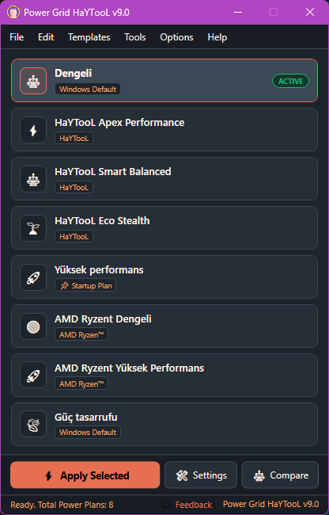
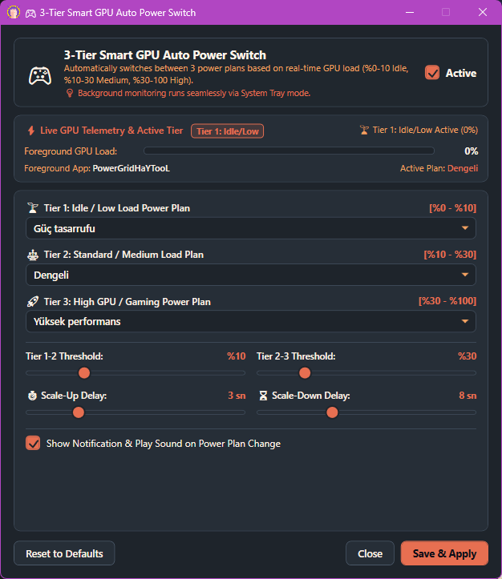
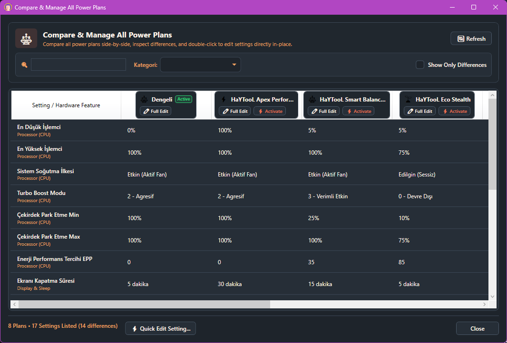

# Power Grid HaYTooL
**Next-Generation Intelligent Windows Power Management & GPU-Aware Automation**  
*The Official Power Utility of the HaYTooL Portal Ecosystem*

[-0078D6?logo=windows&logoColor=white)](https://github.com/HaYToKoRaZ/Power-Grid)

---

### 🌐 Language Quick Switch / Hızlı Dil Seçimi

&nbsp;&nbsp;&nbsp;

> [!TIP]
> 🇹🇷 **Türkçe kullanıcılar için:** Doğrudan Türkçe detaylı kullanım kılavuzu ve özellik anlatımına geçmek için [**buraya (🇹🇷 Türkçe)**](#turkce-aciklama) tıklayabilirsiniz.

---

## 🇬🇧 English Version

### ⚡ Overview
**Power Grid HaYTooL** is a modern, lightweight, single-executable Windows power scheme manager engineered for gamers, power users, and eco-conscious system administrators. Built on **.NET 10 WPF**, it eliminates the cumbersome Windows Control Panel navigation by providing instant access, visual comparisons, deep CPU power parameter fine-tuning, and most importantly: **autonomous GPU-driven power switching**.

---

### 🎮 The Flagship Innovation: Smart GPU-Aware Power Switching
Most modern PCs consume excessive power or suffer performance micro-stutters because users are locked into a single static Windows power plan:
* **The Problem:** Leaving "High Performance" on 24/7 keeps CPU clocks pegged at maximum voltage, spinning fans loud and wasting electricity even while reading articles or idle. Conversely, using "Balanced" or "Power Saver" introduces input latency, delayed turbo clocks, and frame drops during intense gaming bursts.
* **The Solution:** **Power Grid HaYTooL's Smart GPU Switcher**. It constantly tracks active 3D GPU load across 3 configurable threshold tiers:

| Tier | GPU Load Range | Recommended Mode | Behavioral Advantage |
|:---:|:---:|:---:|:---|
| **Tier 1 (Low / Idle)** | `0% - 10%` | *HaYTooL Eco Stealth* / *Power Saver* | Drops CPU clocks down, enables deep core parking, keeps fans dead silent, cuts wall wattage. |
| **Tier 2 (Medium / Daily)** | `10% - 30%` | *HaYTooL Smart Balanced* | Smooth responsive clock scaling for 4K video playback, streaming, and multi-tab browsing. |
| **Tier 3 (High / Gaming)** | `30% - 100%` | *HaYTooL Apex* / *Ultimate Perf* | 100% unparked CPU cores, zero-latency turbo boost, and instant clock availability. |

#### 🌿 Environmental & Hardware Benefits:
1. **Noticeable Energy Savings:** Reduces unnecessary power draw during daily desktop tasks.
2. **Lower Temperatures & Longer Lifespan:** Keeps GPU/CPU cool and thermal stress minimized when intense compute power isn't needed.
3. **Whisper-Quiet Operation:** Fan curves stay at minimal RPM during idle, eliminating annoying jet-engine noise.
4. **Zero-Lag Transition:** Switch delay timers (`TriggerDelay` & `RevertDelay`) prevent erratic plan oscillation, smoothly leaping to maximum clock states the moment your game renders.

---

### 📸 Screenshots

#### Main Window & Plan Overview

#### Smart GPU-Load Auto Switching (3-Tier Engine)

#### Side-by-Side Power Plan Comparison Tool

 
<i>(Click on any screenshot to view full resolution)</i>

---

### ✨ Key Features at a Glance

* 🚀 **Smart GPU Auto-Switch:** Autonomous 3-tier dynamic switching between low, medium, and gaming power plans based on live GPU telemetry.
* 📊 **Side-by-Side Plan Comparator:** Compare any two Windows power plans side-by-side to visually inspect differences in minimum/maximum processor states, cooling policies, turbo boost, and AC/DC timeouts.
* 🛠️ **Deep Plan Editor:** Configure advanced power parameters directly without dealing with confusing GUIDs or command lines.
* 🔔 **Sleek Non-Intrusive Toast Notifications:** Clean, modern slide-in notifications near the system clock informing you of plan changes and automated switches.
* 📌 **User-Specific Startup Plan:** Designate an automatic startup power plan tied directly to your Windows user account.
* 📦 **Automated ZIP Backups & Instant Restore:** Automatically snapshots all power plans into timestamped ZIP archives before modifications, with a built-in one-click restore dialog.
* 🎨 **Dual-Theme Engine (14 Curated Palettes):** Includes both Dark and Light variants (Sunset Boulevard, Botanical Garden, Nordic Slate, Obsidian Black, Silver Blue, Ocean Depths, etc.) with custom-styled controls and perfect contrast.
* 🖱️ **Desktop Context Menu Integration:** Add/remove the clean `Power Grid (HaYTooL)` right-click cascade menu to your desktop with zero administrator popups (`HKCU`).
* 🕒 **System Tray with Live Active Plan:** Hover over the system tray icon to instantly view the active plan name. Includes a quick switch right-click tray menu.
* 🔓 **Unlock Hidden Windows Power Settings:** Unhide buried processor attributes (Turbo Boost aggressiveness, core parking thresholds, PCIe ASPM, USB suspend) in standard Windows Control Panel with a single click.
* ⚡ **Pre-tuned Custom HaYTooL & AMD Ryzen™ Profiles:** Built-in optimized profiles ready to inject with 1-click: *Apex Performance*, *Smart Balanced*, *Eco Stealth*, and *AMD Ryzen™ High/Balanced*.
* 🌐 **Modular Dual-Language Architecture:** Fully bilingual in English and Turkish, with automatic OS language detection.
* 💼 **Ultra-Portable Single Executable:** Zero external database, zero bloated dependencies, 100% portable `PowerGridHaYTooL.exe`.

---

### 📥 Download & Usage

1. Go to the [**Latest Releases**](https://github.com/HaYToKoRaZ/Power-Grid/releases/latest) page.
2. Download `PowerGridHaYTooL.exe` (Portable) or the automated Setup package.
3. Launch `PowerGridHaYTooL.exe` — no installation or external drivers required!

---

 

 

## 🇹🇷 Türkçe Açıklama

### ⚡ Genel Bakış
**Power Grid HaYTooL**, Windows işletim sisteminde güç planlarını yönetmeyi çocuk oyuncağı haline getiren, **.NET 10 WPF** teknolojisiyle sıfırdan geliştirilmiş yeni nesil, taşınabilir ve akıllı bir masaüstü güç yöneticisidir. **HaYTooL** portalı ekosisteminin resmi güç aracı olan uygulama; klasik ve karmaşık Denetim Masası adımlarını tarihe gömer.

---

### 🎮 En Önemli İnovasyonumuz: Akıllı GPU Otomatik Güç Anahtarı
Masaüstü ve dizüstü bilgisayar kullanıcılarının en sık karşılaştığı açmaz şudur:
* **Mevcut Sorun:** Bilgisayarı sürekli "Yüksek Performans" veya "Nihai Performans" modunda tutmak; siz sadece webde gezinirken, video izlerken veya metin yazarken bile işlemci çekirdeklerini en yüksek frekansta ve yüksek voltajda çalıştırır. Bu durum gereksiz yere fan sesi üretir, donanımı ısıtır ve elektrik faturasını kabartır. Tersi durumda sistemi "Dengeli" veya "Güç Tasarrufu" modunda unuttuğunuzda ise oyun açıldığında ani takılmalar (stutter), gecikmeler ve düşük FPS yaşanır.
* **Akıllı Çözüm:** **Power Grid HaYTooL'un Akıllı GPU Anahtarı**. Arka planda 3D ekran kartı yükünü saniye saniye izleyerek gücü 3 farklı eşik kademesinde tam vaktinde otomatik değiştirir:

| Kademe | GPU Kullanım Aralığı | Önerilen Güç Planı | Sağladığı Avantaj |
|:---:|:---:|:---:|:---|
| **1. Kademe (Boşta / Düşük)** | `%0 - %10` | *HaYTooL Eco Stealth* / *Güç Tasarrufu* | İşlemci hızını ve voltajını düşürür, gereksiz çekirdekleri uyutur, fanları tamamen susturur ve sıfır elektrik israfı sağlar. |
| **2. Kademe (Orta / Günlük)** | `%10 - %30` | *HaYTooL Smart Balanced* | 4K video izleme, çok sekmeli tarayıcı ve günlük işlerde yumuşak, akıcı ve dengeli hızlanma. |
| **3. Kademe (Yüksek / Oyun)** | `%30 - %100` | *HaYTooL Apex* / *Nihai Performans* | Oyun veya 3D render açıldığı an tüm çekirdek kilitlerini açar, Turbo Boost'u şahlandırır ve sıfır gecikmeli tam güç sunar. |

#### 🌿 Enerji Tasarrufu ve Donanım Ömrü Faydaları:
1. **Elektrik Faturasında Tasarruf:** Günde saatlerce açık kalan bilgisayarların masaüstü boştaki güç tüketimini ciddi oranda aşağı çeker.
2. **Düşük Sıcaklık & Sessizlik:** Oyun oynamadığınız anlarda fan gürültüsünü keser, kasa içi bileşenlerin serin çalışmasını sağlayarak donanım ömrünü uzatır.
3. **Akıllı Gecikme Filtresi (`Trigger` & `Revert` Delay):** Anlık dalgalanmalarda gereksiz plan değişimlerini engeller; sistem sadece gerçekten yük altına girdiğinde veya yük bittiğinde kararlı biçimde geçiş yapar.

---

### 📸 Ekran Görüntüleri

#### Ana Pencere ve Güç Planları Listesi

#### Akıllı GPU Otomatik Güç Anahtarı (3 Kademeli Motor)

#### Güç Düzenlerini Yan Yana Karşılaştırma Aracı

 
<i>(Orijinal boyutta incelemek için görselin üzerine tıklayabilirsiniz)</i>

---

### 🌟 Öne Çıkan Tüm Özellikler

* ⚡ **Akıllı GPU Otomasyonu:** Canlı GPU yüküne göre 3 kademede güç planlarını otomatik değiştirir.
* ⚖️ **Güç Planı Karşılaştırma Aracı:** Sisteminizdeki herhangi iki güç planını yan yana koyarak işlemci durumları, soğutma politikaları ve uyku süreleri arasındaki farkları satır satır gösterir.
* 🛠️ **Gelişmiş Plan Düzenleyici:** Seçtiğiniz güç planının minimum/maksimum CPU kullanımını, fan soğutma ilkesini ve ekran kapanma sürelerini GUID karmaşası olmadan anında düzenleyin.
* 🔔 **Zarif Toast Bildirimleri:** Güç modu ister elinizle ister otomatik değiştiğinde saatin hemen üzerinde göz yormayan, şık bildirim kartı görünür.
* 📌 **Kullanıcıya Özel Açılış Planı:** Bilgisayarı her açtığınızda otomatik olarak devreye girecek varsayılan güç planınızı belirleyin.
* 📦 **Otomatik ZIP Yedekleme & Geri Yükleme:** Güç planlarınızda değişiklik yapılmadan önce tüm planlar tarih damgalı ZIP olarak arşivlenir; tek tıkla geçmiş bir yedeğe geri dönülebilir.
* 🎨 **14 Farklı Görsel Tema (Kusursuz Çift Tema):** Gün Batımı (Sunset), Botanik Bahçe, İskandinav Laciverti, Obsidiyen Siyahı, Kutup Beyazı ve 10'dan fazla özenle seçilmiş renk paletiyle hem koyu hem açık modda mükemmel okunabilirlik.
* 🖱️ **Masaüstü Sağ Tık Menüsü:** Yönetici izni ekranı çıkartmadan masaüstü sağ tık menüsüne `Power Grid (HaYTooL)` menüsünü ekler/kaldırır.
* 🕒 **Sistem Tepsisi & Canlı Aktif Plan Göstergesi:** Saatin yanındaki tepsi simgesine farenizi yaklaştırdığınızda aktif güç planının adı anında görünür; sağ tıklayarak planlar arasında hızla geçiş yapabilirsiniz.
* 🔓 **Windows Gizli Güç Ayarlarını Açma:** Denetim Masasında gizli tutulan Turbo Boost modları, çekirdek park etme (core parking) ve PCIe güç tasarrufu kilitlerini tek tıkla açın.
* 🚀 **Hazır Optimize Edilmiş Profiller:** Tek tıkla sisteme eklenebilen özel şablonlar: *HaYTooL Apex Performance*, *HaYTooL Smart Balanced*, *HaYTooL Eco Stealth*, *Nihai Performans* ve *AMD Ryzen™ Profilleri*.
* 📁 **Sade Yapılandırma (`PowerGridHaYTooL.ini`):** Ayarları çift dilli Türkçe ve İngilizce açıklamalarıyla temiz bir INI dosyasından yönetebilirsiniz.
* 💼 **Tamamen Taşınabilir (Portable):** Kurulum gerektirmeyen tek bir `PowerGridHaYTooL.exe` dosyasıdır.

---

### 🚀 İndirme ve Hızlı Başlangıç

1. [**Son Sürümler (Releases)**](https://github.com/HaYToKoRaZ/Power-Grid/releases/latest) sayfasına gidin.
2. `PowerGridHaYTooL.exe` dosyasını indirin.
3. Çift tıklayarak anında çalıştırın — ek hiçbir kütüphaneye veya kuruluma gerek yoktur!

---

### 📄 Lisans
Bu proje **MIT Lisansı** ile lisanslanmıştır. Detaylar için [LICENSE](LICENSE) dosyasına göz atabilirsiniz.

  Power Grid HaYTooL bir <b>HaYTooL</b> portalı açık kaynak projesidir.

